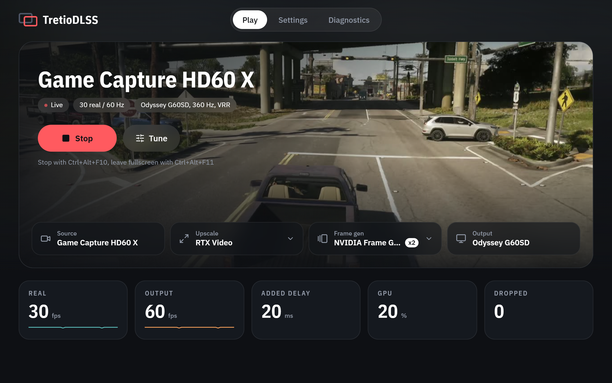

# TretioDLSS

https://github.com/user-attachments/assets/a8d96d64-7c55-4995-b955-77fe6599925b

A Windows app that takes a live console picture (HDMI capture card or a PS Remote Play window), upscales it and generates extra frames, and shows it on a monitor or TV with as little added delay as possible. "Tretio" is Swedish for thirty: 30 fps in, 60 or more out.

Made for 30 fps console games like GTA VI (Grand Theft Auto 6) on PS5 and Xbox Series X|S: plug the console into a capture card, and play it on your PC monitor at 60, 120 fps or more, sharper and smoother than the console sends it.



## Features

- Capture cards through Media Foundation, with the card's sound passed through in sync. Window capture for PS Remote Play.
- Upscaling: RTX Video, FSR 1, NVIDIA Image Scaling, bicubic and bilinear.
- Frame generation: NVIDIA Frame Generation, DLSS Frame Generation (x3 and x4 on RTX 40 through an in-memory unlock), RIFE on any GPU, and AMD Frame Generation, x2 to x4.
- Cadence detection that finds the real frames in a 60 Hz signal (30 real in 60), so only new frames are processed.
- Low-delay output window with VRR or vsync pacing, HDR output, TV mode and a stats overlay.

DLSS Super Resolution cannot run on captured video, because it needs motion vectors and depth from the game engine. DLSS Frame Generation can: it runs on the captured frames with zero motion vectors and estimates the motion itself.

## Build

Requires the .NET 10 SDK and Node.js.

```
dotnet build TretioDLSS.sln -c Debug
dotnet test TretioDLSS.sln
```

DLSS Frame Generation needs NVIDIA's DLSS SDK files and the MSVC x64 tools: run `tools/dlss/fetch.ps1` once, and the build compiles `Native/TretioNgx`.

The frontend lives in `Frontend/` (`npm run dev`, `npm run lint`, `npm run build`). `tools/pack.ps1 -Version <v>` builds the installer.

Built with C# on .NET 10, PhotinoX, React with daisyUI, and a Direct3D 11 pipeline with a native output window.
